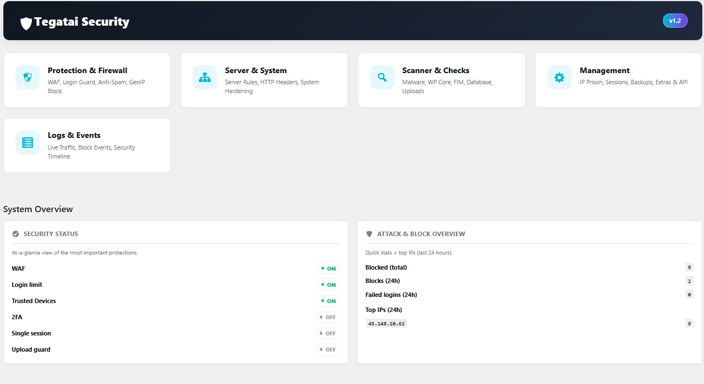
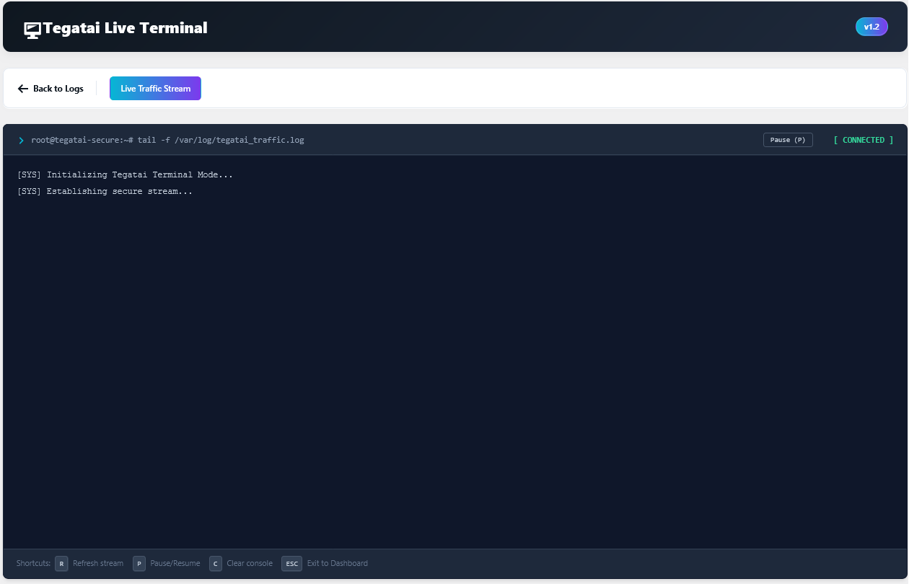
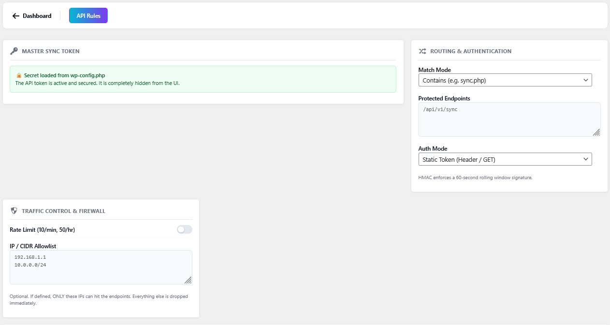
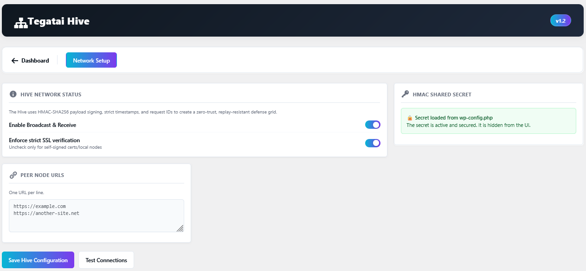

<p align="center"></p>


# 🛡️ Tegatai Secure (WordPress Security)

**Tegatai Secure** is a high-performance, enterprise-grade security suite for WordPress. Unlike traditional security plugins that process everything at the PHP level, Tegatai integrates directly with your server (**Nginx, Apache, or LiteSpeed**) to block malicious traffic, bots, and brute-force attacks *before* WordPress is even loaded.

It features a zero-load architecture, multiple deep-scanning engines, cryptographic authentication systems, hardened API protection, and encrypted remote communication.

# 📸 Screenshot





---

# 🚀 Key Advantages

* **Zero-Load Protection:** Malicious requests are dropped directly by the web server via auto-generated `nginx.conf` or `.htaccess` rules.
* **Zero-Knowledge Architecture:** Sensitive secrets and master tokens can be completely removed from the database and securely stored in a secrets file outside the web root (or `wp-config.php`).
* **Cryptographic API Protection:** HMAC-based request signing with replay protection and rolling timestamps.
* **Enterprise Security without Bloat:** Lightweight architecture focused on performance and real protection.
* **Server-Level Hardening:** Deep integration with Nginx, Apache, and LiteSpeed.
* **Fully CLI Compatible:** Designed to avoid unnecessary PHP timeouts and support large-scale automation.
* **Fully Internationalized:** Translation-ready and multilingual.

---

# 🔐 Zero-Knowledge Security Architecture

Tegatai Secure introduces a hardened secret-management system designed to minimize attack surfaces.

## 🗝️ Sudo Vault

Critical secrets can be protected using a dedicated Sudo Vault system.

Instead of exposing master keys in the WordPress dashboard or storing them permanently in the database, Tegatai supports secure secret handling through a secrets file outside the web root (see below) or `wp-config.php`.

### Example:

```php
// Generate a Bcrypt hash:
// php -r "echo password_hash('YourSecretPin123', PASSWORD_BCRYPT);"

define('TEGATAI_SUDO_PIN', '$2y$10$YourGeneratedHashHere');
```

The PIN itself is never stored in the database.

---

## 🔑 API Secret Locking

Sensitive API secrets can also be fully externalized:

```php
define('TEGATAI_API_SECRET', 'your-super-long-random-secret');
define('TEGATAI_HIVE_SECRET', 'your-hive-network-secret');
```

When configured:

* Secrets are hidden from the UI
* Secrets are never exposed through AJAX
* Secrets are removed from normal database workflows
* Database leaks become significantly less dangerous

---

## 📁 Secrets File (outside the web root)

All secrets can live in their own PHP file outside the web root instead of `wp-config.php`.

Default location (one level above the WordPress directory):

```
/var/www/example.com/htdocs/                          <- WordPress
/var/www/example.com/secrets/tegatai-secrets.php      <- secrets
```

Content:

```php
<?php
return [
    'TEGATAI_HIVE_SECRET'   => 'your-hive-network-secret',
    'TEGATAI_API_SECRET'    => 'your-super-long-random-secret',
    'TEGATAI_SUDO_PIN'      => '$2y$10$YourGeneratedHashHere',
    'TEGATAI_BACKUP_SECRET' => 'your-backup-key',
    'TEGATAI_ABUSEIPDB_KEY' => 'your-abuseipdb-api-key',
];
```

Another location can be set in `wp-config.php` (path only, no secret):

```php
define('TEGATAI_SECRETS_FILE', '/path/outside/webroot/tegatai-secrets.php');
```

The file can also be created in **Tegatai → Management → Secrets** with "Create secrets file": it copies the secrets currently defined in `wp-config.php`; afterwards remove the `define()` lines from `wp-config.php`.

Only these five names are read. A value that is still defined in `wp-config.php` takes precedence. Keep `TEGATAI_BACKUP_SECRET` unchanged when moving it, otherwise existing backups cannot be decrypted. Recommended permissions: `chmod 600`, owned by the PHP user.

---

## 🚩 AbuseIPDB Reporting

Tegatai can report banned IPs to [AbuseIPDB](https://www.abuseipdb.com) (Firewall tab → "Report bans to AbuseIPDB").

* Reported bans: honeypot URL, 404 instant ban, 404 scan and the login traps, including bans received through The Hive.
* Reports are queued and sent in the background via WP-Cron; a ban never waits for the API.
* Reports contain only the IP, the category and the type of the ban. No URLs, usernames or other request data are sent. Private and reserved IPs are never reported.
* The same IP is reported at most once per 15 minutes. When the AbuseIPDB limit is reached (HTTP 429), sending pauses until the API allows it again.

The API key is created in your AbuseIPDB account and stored in the secrets file:

```php
'TEGATAI_ABUSEIPDB_KEY' => 'your-abuseipdb-api-key',
```

---

## 🎭 WP Masking (nginx)

Hides the WordPress structure in the pages visitors receive (Server & System → WP Masking).

* **Plugin and theme paths:** `/wp-content/plugins/<folder>/` and `/wp-content/themes/<theme>/` (or your own plugin directory) are shown as `/assets/<name>/`. The names are set per plugin and theme; empty fields get an automatic short name.
* **WordPress core:** `/wp-includes/` becomes `/lib/`, `/wp-json/` becomes `/api/`, `admin-ajax.php` becomes `/ajax` (all names can be changed). `/wp-json/` keeps working for The Hive and other sites.
* **Versions and identifiers:** removes `?ver=` parameters, script/style ids, generator tags, RSD/wlwmanifest/shortlink/REST links, the emoji script, the speculation rules and the `X-Pingback` header.
* **Hide file names:** file names of masked files are replaced by a neutral name per file, e.g. `/assets/bar/css/kanri-bar.css` → `/assets/bar/css/t3f9a0c1d2e4`. The folders stay, so relative URLs inside CSS and JS keep working (files loaded that way keep their real name). A changed file gets a new name, which also makes browsers load the new version.
* **Block original paths:** direct requests for the original paths of masked entries answer 404. Logged-in users and files loaded by pages of the site itself keep access; `/wp-json/tegatai/` (The Hive) stays reachable.

nginx maps the new paths back to the real files (static files only, never PHP). The rules are part of `tegatai-nginx.conf`. Activation:

1. Switch the options on and save the names.
2. Reload nginx.
3. Click **Check new paths**.

Tegatai requests every new path once and only uses the paths that answered with the real file, so a missing nginx reload never breaks the site. New file names are found when pages are visited; Tegatai adds them to the rules and checks them every hour, and uses them once nginx was reloaded. Renamed paths keep working for cached pages. New paths and blocking need nginx (with Apache or LiteSpeed the check finds no working paths and nothing is changed); removing versions and identifiers works on every server.

---

# 🌐 Tegatai Hive (Distributed Threat Network)

Tegatai Hive allows multiple WordPress installations to communicate and synchronize threat intelligence securely.

## Features

* **Ed25519 node keys (protocol v2):** every node signs its messages with its own private key; the other nodes only know its public key. A compromised node can never send messages in the name of another node.
* **End-to-end encryption:** v2 payloads (IP, reason, level) are encrypted with `crypto_box` (X25519 keys derived from the same Ed25519 keys) – also behind a CDN or proxy that terminates TLS.
* **Signed recipient:** every message names its receiver, so it cannot be replayed to another node.
* Strict timestamp validation (±60 s) and one-time request IDs (replay protection)
* Distributed IP ban synchronization with per-peer rate limit and never-ban allowlist
* **HMAC-SHA256 (protocol v1)** for nodes that are not switched yet; a peer with an Ed25519 key is never accepted over HMAC (no downgrade)

## Setting up node keys

Tegatai never creates keys on its own. Create the key once per site on the server, **as the site's PHP-FPM user** (never as root):

```bash
sudo -u <fpm-user> wp tegatai hive-keygen --path=/path/to/site
```

* The private key is written to `secrets/tegatai-hive-key.php` next to `tegatai-secrets.php` (outside the web root, file `0600`, folder `0700`). It is never printed, and the command refuses to overwrite an existing key (`--replace` creates a new one; all peers then need the new public key).
* Another location: `define('TEGATAI_HIVE_KEY_FILE', '/path/tegatai-hive-key.php');` or the key itself as `TEGATAI_HIVE_PRIVATE_KEY` in `wp-config.php`.
* The command prints the line for the other nodes. It is also shown on the Hive page and with `wp tegatai hive-pubkey`.

Peer list (one per line), on every node all other nodes:

```text
https://site-a.example | ed25519:<public key of site A>
https://site-b.example | ed25519:<public key of site B>
https://old-node.example | tg_hmac_pair-secret        (not switched yet, HMAC)
```

Nodes can be switched one by one: peers with a key use v2, peers without one keep using HMAC. To revoke a node, remove its line on the others.

---

# 🛡️ API Gateway & Endpoint Protection

The integrated API Gateway protects custom endpoints and synchronization routes.

## Included Features

* Static Token Authentication
* HMAC v2 Authentication
* Replay Protection
* Timestamp Validation
* Request-ID Verification
* IPv4 & IPv6 CIDR Allowlists
* Rate Limiting
* ReDoS-Protected Regex Routing
* CLI / WP-CLI bypass support
* Tarpit delay system for failed authentication

### HMAC Example

```php
$method = 'POST';
$uri = '/api/sync';            // exact REQUEST_URI incl. query string
$timestamp = time();
$req_id = bin2hex(random_bytes(16));
$body = json_encode(['example' => true]);   // raw request body ('' for GET)

$signature = hash_hmac(
    'sha256',
    $method . '|' . $uri . '|' . $timestamp . '|' . $req_id . '|' . hash('sha256', $body),
    'YOUR_SECRET'
);
// Headers: X-Tegatai-Timestamp, X-Tegatai-Req-Id, X-Tegatai-Signature
```

> **Breaking change (1.4.2):** The signature now covers the HTTP method and a SHA-256 hash of the raw body. Clients using the old `uri|timestamp|req_id` format must be updated. Each `req_id` is accepted exactly once.

---

# 🔥 Complete Feature List

## 🛡️ Web Application Firewall (WAF) & Network

* Bad Bot Blocking
* AI & SEO Bot Blocking
* GeoIP Filtering
* Rate Limiting
* 404 Trap System
* IP Prison
* Distributed Threat Sync (Hive)
* REST API Restriction

---

## ⚡ Server Rules Engine (Nginx / Apache / LiteSpeed)

* Disable PHP in Uploads
* Dotfile Protection
* Sensitive File Protection
* XML-RPC Blocking
* Hotlink Protection
* System File Shielding
* Custom server rule generation
* WP Masking: neutral paths for plugins, themes and WordPress core (nginx)

---

## 🔐 Authentication & Login Guard

* Two-Factor Authentication (TOTP / Email)
* Login Attempt Limits
* Magic Links
* Trusted Device Monitoring
* Custom Login Slugs
* Hide `/wp-admin/`
* Idle Logout
* Session Hijack Detection

---

## 🛑 Anti-Spam & Content Protection

* Cloudflare Turnstile
* Honeypot Protection
* Bot Timer Validation
* Disposable Email Blocking
* Referrer Checks
* Link Spam Protection

---

## 🔎 Integrity & Malware Scanners

* Malware Scanner
* File Integrity Monitor (FIM)
* WordPress Core Verification
* Database Injection Scanner
* Dangerous Option Scanner
* Suspicious Cron Detection
* Uploads Monitoring
* File Permission Auditing

---

## 💻 System Hardening

* Security Headers
* CSP / HSTS / X-Frame-Options
* Privilege Escalation Protection
* WP Footprint Removal
* User Enumeration Blocking
* Admin Honeypot
* File Editor Disabling

---

## 👥 Session Security

* IP & Browser Validation
* Single Session Enforcement
* Remote Session Termination
* Active Session Monitoring

---

## 💾 Secure Backups

* Automated Scheduling
* Remote FTP Transfer
* AES-256-CBC Encryption
* Encrypted Credential Storage

---

## 📡 Logging & Monitoring

* Live Traffic Logs
* WAF Event Logs
* Security Timeline
* Discord / Slack Notifications
* Real-Time Threat Monitoring

---

# ⚙️ Installation

## Standard Installation

1. Upload the plugin to:

```text
/wp-content/plugins/tegatai-secure
```

2. Activate the plugin inside WordPress.
3. Open **Tegatai Secure** in the admin dashboard.
4. Configure your preferred protection modules.

---

## Nginx Integration

Tegatai generates an optimized `tegatai-nginx.conf` file.

Example:

```nginx
server {
    # Existing configuration

    include /path/to/wordpress/tegatai-nginx.conf;
}
```

---

## Apache / LiteSpeed

Rules are automatically injected into `.htaccess`.

---

# ⚙️ Requirements

* WordPress 7.0+
* PHP 8.x+
* Recommended: Nginx / OpenResty / LiteSpeed

---

# 💻 CLI Compatibility

Tegatai Secure is designed to work in large-scale and automated environments.

Features include:

* WP-CLI compatibility
* Timeout-safe workflows
* Cron-safe execution
* Large dataset handling
* Server automation support

---

# 🔒 Security Philosophy

Tegatai Secure follows a minimalistic security philosophy:

* Prevent attacks before PHP loads
* Reduce attack surfaces
* Avoid unnecessary dependencies
* Keep secrets outside the database whenever possible
* Prioritize performance and server stability
* Focus on real-world protection instead of marketing features

---

# 🤝 Contributing

See `CONTRIBUTING.md`

---

# 🚨 Security Reporting

If you discover a vulnerability, please report it privately.

Contact:

```text
tegatai@anime-mitsuketa.tokyo
```

---

# 📄 License

GPL v2 or later.

See `LICENSE`.

---

# 📜 Changelog

Current Version: `2.0.2`

See `CHANGELOG.md` for detailed release notes.

