<p align="center"></p>


# Tegatai Secure

Security plugin for WordPress. It combines a firewall, login protection, anti-spam, server rules, HTTP headers, path masking, scanners, session control, encrypted database backups and IP ban sharing between your own sites.

Rules that the web server can enforce are written to `tegatai-nginx.conf` (nginx) or `.htaccess` (Apache, LiteSpeed), so those requests are blocked before PHP starts. Everything else runs inside WordPress. Every module can be switched on and off on its own.

Current version: `2.2.3` – see [CHANGELOG.md](CHANGELOG.md).

---

## Screenshots

Taken on an empty demo site with sample data. All IP addresses are documentation ranges.

**Dashboard** – security score, recent events, blocked requests, active modules

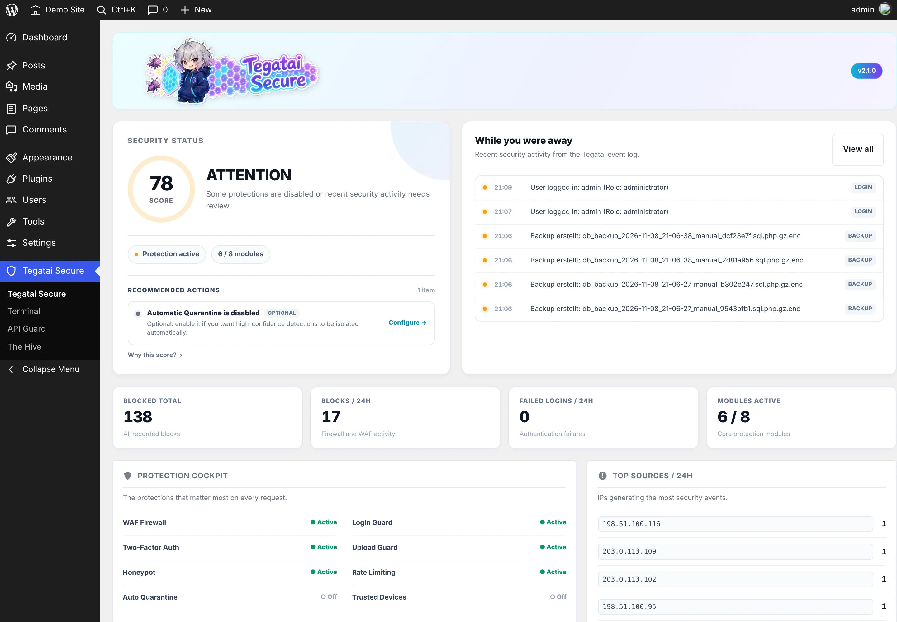

**Firewall** – WAF switches, URL whitelist, custom regex rules, IP lists

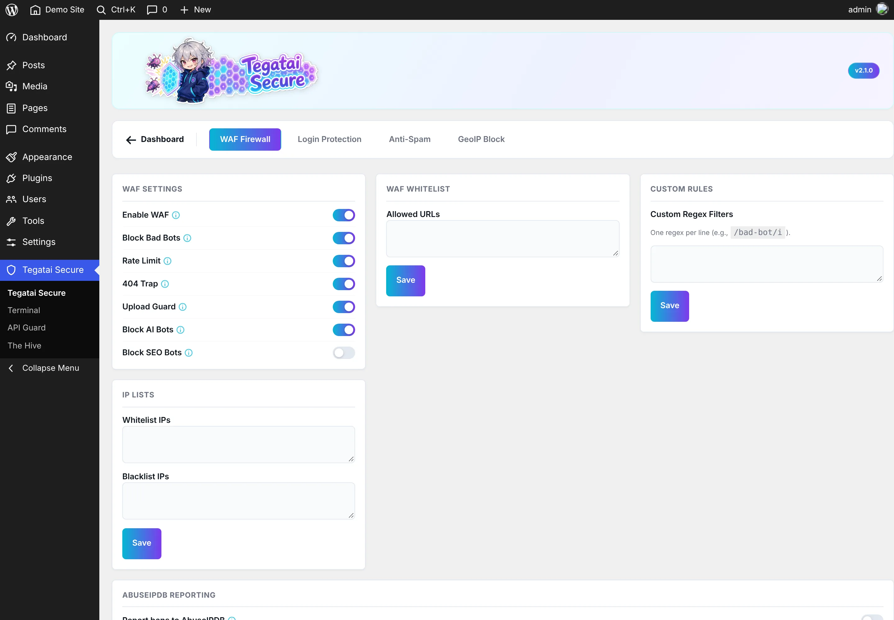

**IP Prison** – active bans with source and expiry, release per IP

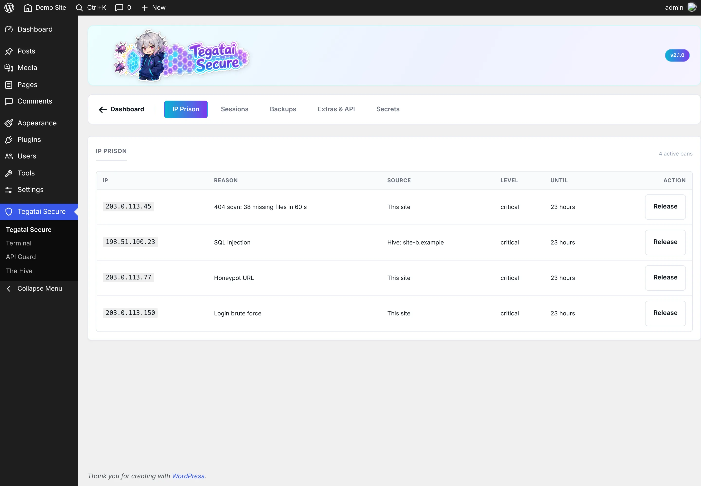

**Login protection** – login limit, custom login slug, trusted devices, idle logout, 2FA with backup codes

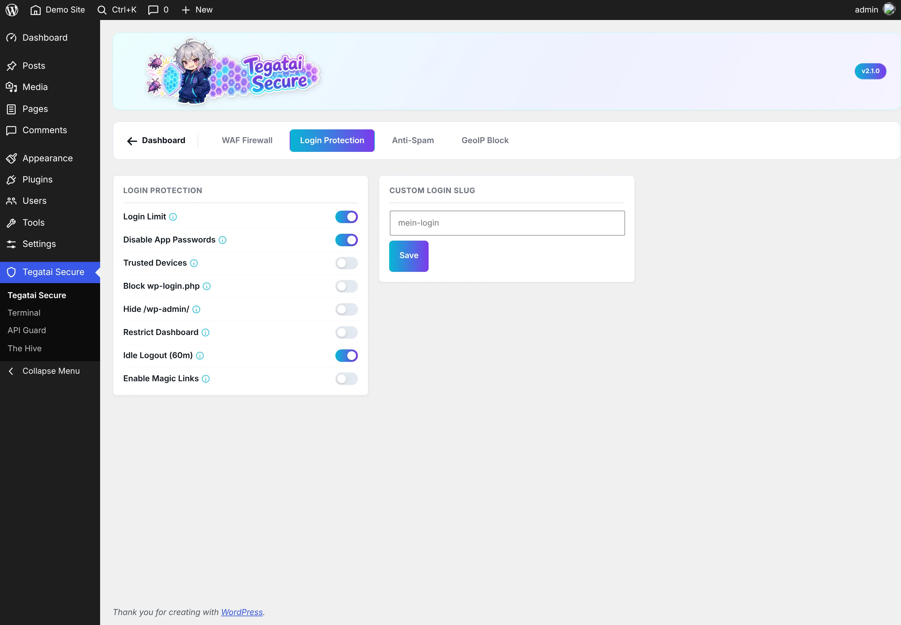

**Server rules** – rules written to `tegatai-nginx.conf` / `.htaccess`

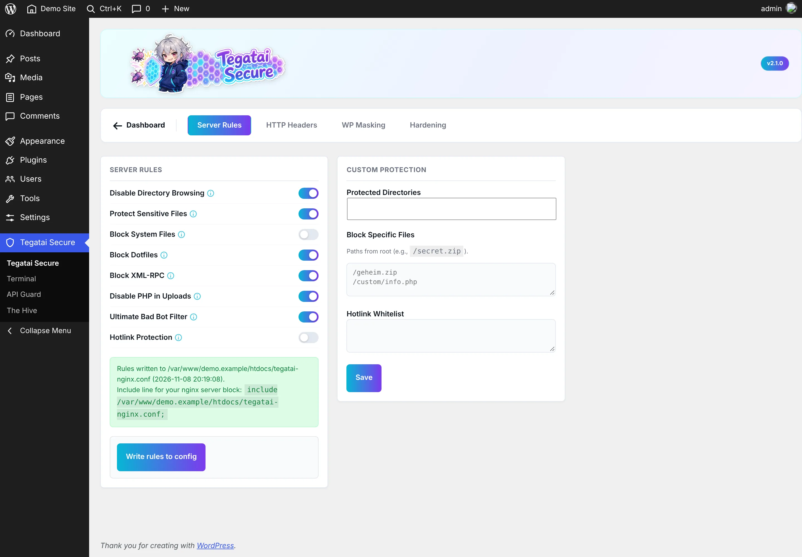

**WP Masking** – neutral paths for plugins, themes and WordPress core (nginx)

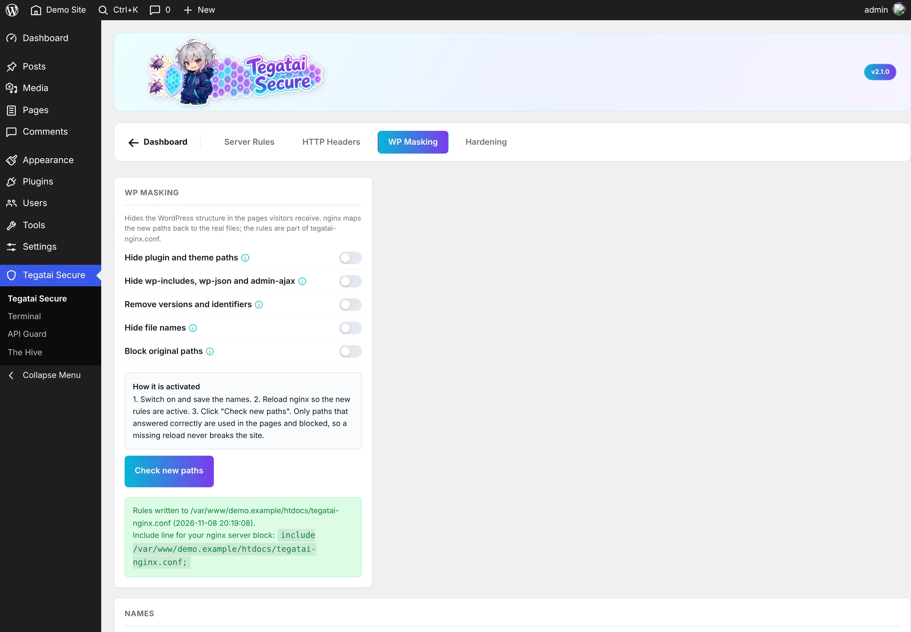

**Scanner** – malware and integrity scan, file snapshot

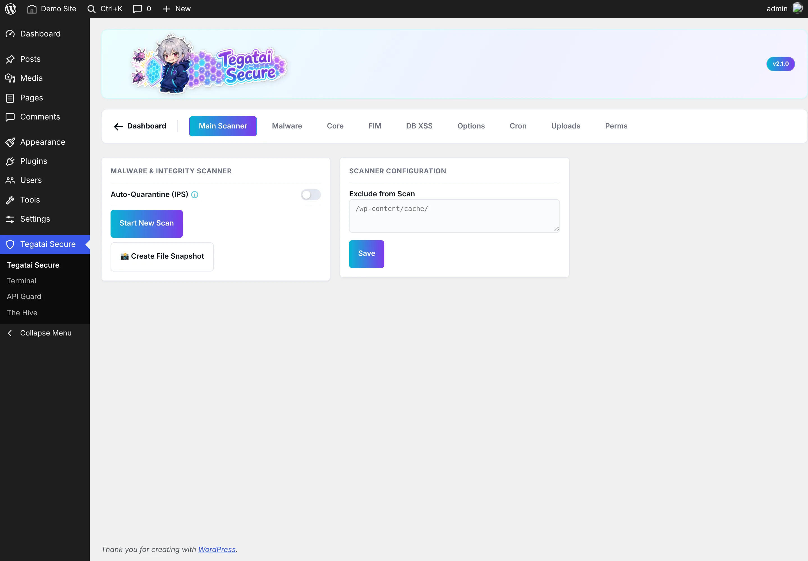

**Secrets** – where each secret is loaded from, commands to create them

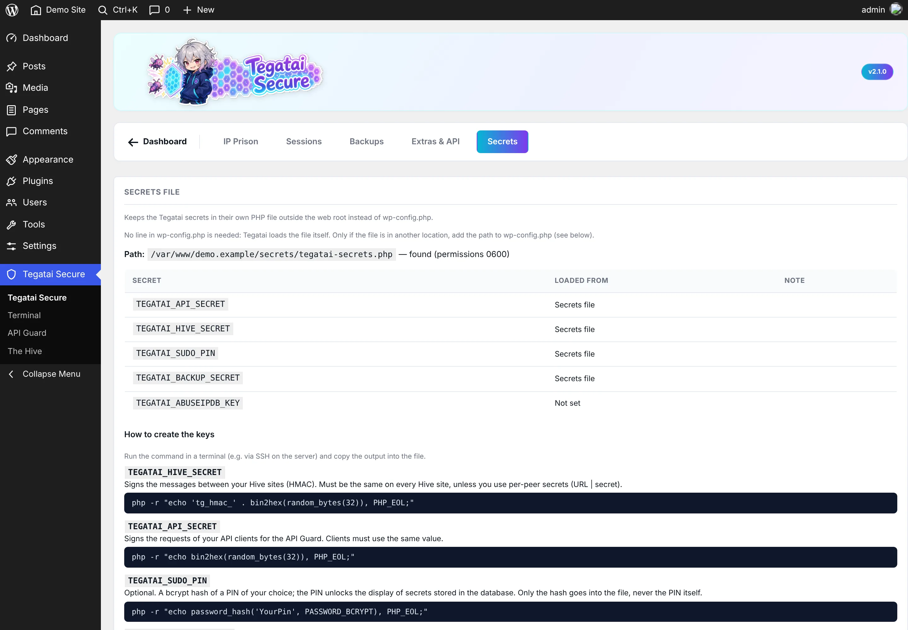

**The Hive** – node key, peer list, ban policy

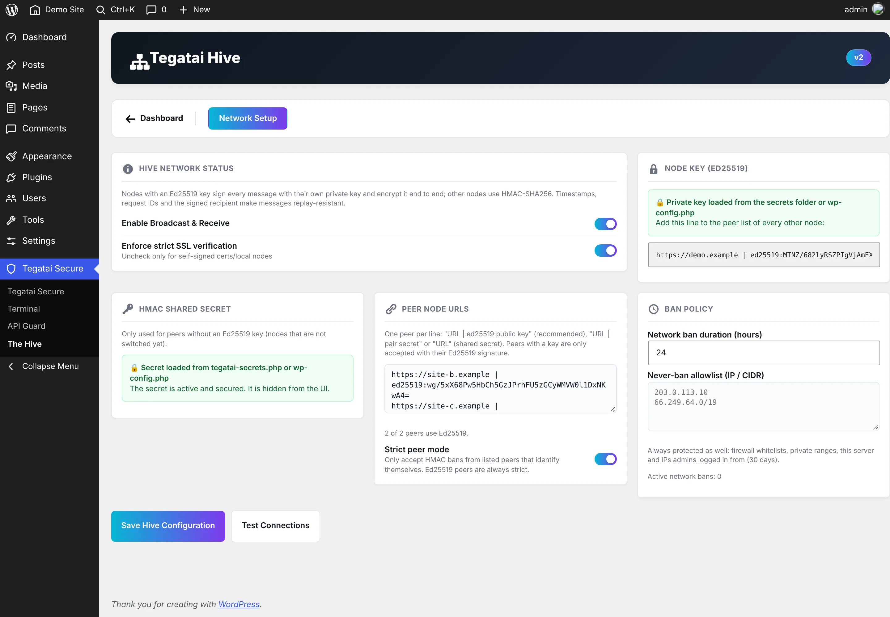

**API Guard** – token / HMAC protection for your own endpoints

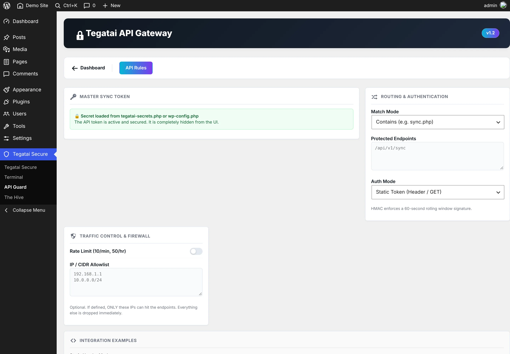

**Terminal** – live view of the traffic log

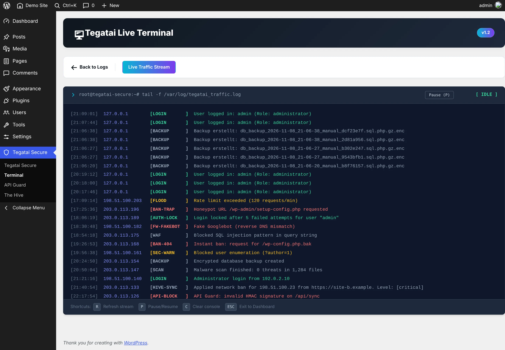

---

## Requirements

* WordPress 7.1 or newer
* PHP 8.4 or newer with OpenSSL and sodium; zlib for the GeoIP database
* nginx, Apache or LiteSpeed (WP Masking needs nginx)
* WP-CLI to create the Hive and backup keys

---

## Features

### Dashboard

* Security score with the reasons behind it and a list of recommended settings
* Recent security events and the most active blocked IPs of the last 24 hours
* Status widget on the WordPress dashboard

### Firewall

* WAF: checks URL, query string and request body for SQL injection, script injection, path traversal and PHP code patterns. Users who may edit posts are not checked.
* Own regex rules (one per line, with a check against slow patterns) and a URL whitelist
* IP whitelist and blacklist (one IP per line)
* Bad bot filter (attack tools and scripted clients) and optional blocks for AI crawlers and SEO crawlers. Real search engine bots are verified by reverse DNS and let through.
* Rate limit: 180 requests per minute, 60 for AJAX and API requests, then HTTP 429
* 404 trap: 20 not-found requests within 5 minutes ban the IP for 1 hour. Requests for typical scanner targets (`.env`, `phpmyadmin`, `shell.php` and others) ban it for 24 hours at once.
* Trap URL: a path listed as `Disallow` in `robots.txt`; a request for it bans the IP for 24 hours (part of the WAF)
* Upload guard: blocks uploads of executable files and scripts with a disguised extension
* Bans can be reported to AbuseIPDB (optional, see "External services")

### Login

* Login limit: 5 failed logins within 15 minutes lock the IP for 1 hour
* Custom login URL, blocking of `wp-login.php` and hiding of `/wp-admin/` for logged-out visitors
* Two-factor authentication for administrators: email code, authenticator app (TOTP) or both; one-time backup codes to download
* Email warning on a login from an unknown device
* Dashboard only for administrators and editors
* Logout of administrators after 60 minutes without activity
* Switch off application passwords
* Email alerts and webhook alerts (Discord, Slack) for security events

### Anti-spam

* Hidden honeypot field in the comment form and the login form
* Minimum fill time and referrer check for comments
* Maximum number of links per comment
* List of disposable email domains for comments and registration
* Cloudflare Turnstile or Google reCAPTCHA v2 / v3 (adjustable minimum score) for comments and login

### GeoIP

* Block or allow a list of countries, for the whole site or only for the login and XML-RPC
* Country lookup in a local database (DB-IP "IP to Country Lite"); visitor IPs are not sent anywhere
* Behind a trusted proxy (for example Cloudflare) the country header of the proxy is used
* Unknown countries and a missing database never block (fail open)

### Server rules (written to the nginx file or `.htaccess`)

* No directory listings
* Blocks sensitive files (`.env`, `.sql`, `.bak`, `.log`, `.git`), WordPress files such as `readme.html`, `license.txt` and `wp-config.php`, and dotfiles
* Blocks `xmlrpc.php`
* No PHP execution in the uploads folder
* Bad bot filter on server level
* Hotlink protection for images, with a whitelist of allowed domains
* Own lists of protected folders and blocked files

### HTTP headers

X-Frame-Options, X-Content-Type-Options, X-XSS-Protection, HSTS (optionally with subdomains), Referrer-Policy, Permissions-Policy and a basic Content-Security-Policy.

### WP Masking (nginx)

* Plugin and theme folders appear as `/assets/<name>/`; the names can be set per plugin and theme
* `/wp-includes/`, `/wp-json/` and `admin-ajax.php` get their own paths
* Removes `?ver=` parameters, script and style ids, the generator tag, RSD, wlwmanifest, shortlink and REST links, the emoji script, speculation rules and the `X-Pingback` header
* Optional neutral file names per file and a 404 for the original paths
* New paths are only used after a test request returned the real file

### Hardening

* Hides the WordPress version
* Switches off XML-RPC inside WordPress
* Switches off the theme and plugin file editor
* Blocks user enumeration through `?author=` for logged-out visitors
* Generic login error message instead of "wrong username" or "wrong password"
* Admin username trap: login attempts as `admin`, `administrator`, `root` or `webmaster` ban the IP for 24 hours, unless such an account exists
* Privilege guard: role changes to administrator by users who are not administrators are reverted
* Database cleanup on demand: expired transients, spam and trashed comments, post revisions, table optimization

### Scanners

* Main scanner: runs in the background in steps; compares the WordPress core files with the official checksums and plugin and theme files with a saved snapshot
* Malware scanner: searches PHP and JS files for typical backdoor and obfuscation patterns
* WordPress core check against the checksums of WordPress.org (read only; repairs go through "Re-install version" under Dashboard → Updates)
* File integrity monitor for plugins, must-use plugins and themes
* Database scan for injected scripts in posts, post meta, comments, options and user meta
* Option scan for suspicious values in `wp_options`, with an exception list
* Cron scan for unknown or suspicious scheduled events, with an exception list
* Uploads monitor: finds scripts and executable files in the uploads folder
* Permission check for `wp-config.php`, `.htaccess` and `index.php`
* Quarantine: found files are moved out of reach (by hand or automatically) and can be downloaded or deleted
* Folder exclusions for the scans
* Daily check of the installed plugins against WPVulnerability (optional, off by default)

### IP Prison

List of active bans with reason, source (this site or a Hive peer) and expiry; single IPs can be released.

### Sessions

* List of active sessions per user; end single sessions
* Session ends when the IP address or the browser changes (each optional)
* One session per user
* Maximum session length in minutes
* Successful logins are logged with user, role, IP and browser

### Backups

* Database backups by hand or daily / weekly by WP-Cron; the newest 7 are kept
* Always encrypted: with a public-key backup key (X25519, XChaCha20-Poly1305) or with a secret from the secrets file
* Consistent snapshot of InnoDB tables, low memory use (streamed in 1 MB chunks)
* Download as a gzip SQL file that imports with `mysql` or phpMyAdmin

### Secrets

* Keys, API secrets, captcha secret keys and the webhook URL are read from a PHP file outside the web root or from `wp-config.php`, never from the database
* Status page with a ready shell command to create the file
* Sudo PIN (bcrypt hash) to show secrets in the admin

### Extras

* REST API only for logged-in users
* Disable right-click and text copying on the front end
* Export and import of all settings as a JSON file

### Logs

* Event log in its own database table (30 days, at most 5000 entries)
* Security timeline
* Terminal: live view of the traffic log in the browser

### API Guard (separate page)

Protects your own endpoints (match by "contains", exact path or regex) with a static token or an HMAC signature, timestamp check, one-time request IDs, an IPv4 / IPv6 allowlist, a rate limit and a delay after failed authentication.

### The Hive (separate page)

Shares IP bans between your own WordPress sites. Messages are signed with Ed25519 and encrypted (X25519); sites without a key can use HMAC-SHA256. Per-peer rate limit, ban duration and a never-ban list; whitelisted, private and server IPs are never banned.

### WP-CLI

`wp tegatai hive-keygen`, `wp tegatai hive-pubkey` and `wp tegatai backup-keygen`.

---

## Data storage

* Settings and the event log: WordPress database (own tables `tegatai_logs`, `tegatai_settings`, `tegatai_quarantine`)
* Backups, quarantine, logs, snapshots, GeoIP database and the nginx file: `wp-content/uploads/tegatai-secure/`, protected by `.htaccess`, `web.config` and nginx rules
* Secrets and keys: only in files that you create outside the web root, or in `wp-config.php`

---

## Installation

1. Install the ZIP of a [release](https://github.com/Suzu-chan1990/Tegatai-Secure/releases) under **Plugins → Add New → Upload Plugin**, or copy the plugin folder to `wp-content/plugins/tegatai-secure`.
2. Activate it under **Plugins**.
3. Open **Tegatai Secure** in the admin menu and switch on the modules you want.

### Server rules

**nginx:** Tegatai writes `tegatai-nginx.conf` into its own folder in the uploads directory (`wp-content/uploads/tegatai-secure/server/`). The exact path is shown under **Server**. Include it once in the `server` block and reload nginx:

```nginx
server {
    # ...
    include /path/to/wordpress/wp-content/uploads/tegatai-secure/server/tegatai-nginx.conf;
}
```

Updating from 2.2.1 or older: earlier versions wrote the file into the WordPress folder or to uploads/tegatai-server/. Change the include line to the new path, reload nginx and delete the old file. The Server tab shows a notice while an old file exists.

After changing server rules or WP Masking in Tegatai, reload nginx again.

**Apache / LiteSpeed:** the rules are written into WordPress' `.htaccess` (block `Tegatai-Secure`, placed in front of the WordPress block). Only mod_rewrite is needed, the same as for permalinks.

### Secrets file

Tegatai never stores secrets (keys, API secrets, captcha secret keys, webhook URLs) in the database. It reads them from a PHP file outside the web root, or from constants in `wp-config.php`. Tegatai only reads this file; you create it.

Default location, one level above the WordPress folder:

```text
/var/www/example.com/htdocs/                          <- WordPress
/var/www/example.com/secrets/tegatai-secrets.php      <- secrets
```

Content:

```php
<?php
return [
    'TEGATAI_HIVE_SECRET'   => 'tg_hmac_...',
    'TEGATAI_API_SECRET'    => '...',
    'TEGATAI_SUDO_PIN'      => '$2y$10$...',
    'TEGATAI_BACKUP_SECRET' => '...',
    'TEGATAI_ABUSEIPDB_KEY' => '...',
    'TEGATAI_RECAPTCHA_SECRET' => '...',
    'TEGATAI_TURNSTILE_SECRET' => '...',
    'TEGATAI_ALERT_WEBHOOK'    => 'https://discord.com/api/webhooks/...',
];
```

Another location is set in `wp-config.php` (only the path, no secret):

```php
define('TEGATAI_SECRETS_FILE', '/path/outside/webroot/tegatai-secrets.php');
```

* Only these names are read. A value that is also defined in `wp-config.php` wins.
* **Management → Secrets** shows a ready shell command that writes the complete file (folder `0700`, file `0600`) with all values Tegatai currently knows. Run it as the site's PHP-FPM user, not as root.
* Updating from 2.2.1 or older: secrets that older versions kept in the database (API sync secret, backup secret, Hive shared secret, captcha secret keys, webhook URL) are included in that command. As soon as they are in the file, Tegatai deletes the database copies. Until then they are only read, never written.
* The Secrets tab shows the commands to create each value.

Create values:

```bash
php -r "echo 'tg_hmac_' . bin2hex(random_bytes(32)), PHP_EOL;"           # TEGATAI_HIVE_SECRET
php -r "echo bin2hex(random_bytes(32)), PHP_EOL;"                        # TEGATAI_API_SECRET / TEGATAI_BACKUP_SECRET
php -r "echo password_hash('YourPin', PASSWORD_BCRYPT), PHP_EOL;"        # TEGATAI_SUDO_PIN
```

#### Sudo PIN

`TEGATAI_SUDO_PIN` is a bcrypt hash. The PIN unlocks the display of secrets in the admin (and the generator for new keys). Only the hash is stored, never the PIN.

### Backup key

Backups are encrypted with a backup key (recommended) or with `TEGATAI_BACKUP_SECRET`. Tegatai never writes key files itself: `wp tegatai backup-keygen` prints the key file, and you redirect it into the file, **as the site's PHP-FPM user** (not as root). The Backups tab shows this command with the right paths:

```bash
mkdir -p /var/www/example.com/secrets && chmod 700 /var/www/example.com/secrets && (umask 077; wp tegatai backup-keygen --path=/var/www/example.com/htdocs > /var/www/example.com/secrets/tegatai-backup-key.php.new) && mv -n /var/www/example.com/secrets/tegatai-backup-key.php.new /var/www/example.com/secrets/tegatai-backup-key.php
```

* The key file lives next to `tegatai-secrets.php` (file `0600`, folder `0700`). `mv -n` never overwrites an existing key. Another location: `define('TEGATAI_BACKUP_KEY_FILE', '/path/tegatai-backup-key.php');`
* Every backup gets its own random key, which is sealed to the public key (X25519, `crypto_box_seal`). The data is encrypted in chunks with XChaCha20-Poly1305 (`crypto_secretstream`); changed, reordered or cut-off files are rejected.
* Tegatai never creates this key on its own. To replace a key, move the old file away first; older backups then need a copy of the old file.
* **Keep a copy of the key file outside the server.** Without it the backups cannot be decrypted.
* Optional: if the file only contains `public_key` (the `private_key` line removed and kept offline), the server can still write backups but cannot decrypt them. To download one decrypted, put the full file back for that time.

Without a backup key, backups use the same XChaCha20-Poly1305 chunks with a key derived from `TEGATAI_BACKUP_SECRET` (secrets file). Without either, no backup is written. Older backups (AES-256-GCM from 1.5 to 2.1.0, AES-256-CBC before 1.5) can still be downloaded. AES-256-GCM files are decrypted in memory (PHP has no streaming GCM); for a very large one, the download says how much memory it needs. Decrypted downloads go through a temporary `0600` file in the backup folder, which is deleted right after.

### The Hive

#### Node keys

Tegatai never creates or writes keys on its own. Create the key once per site, **as the site's PHP-FPM user** (not as root). `wp tegatai hive-keygen` prints the key file; the command shown on the Hive page redirects it into the file:

```bash
mkdir -p /var/www/example.com/secrets && chmod 700 /var/www/example.com/secrets && (umask 077; wp tegatai hive-keygen --path=/var/www/example.com/htdocs > /var/www/example.com/secrets/tegatai-hive-key.php.new) && mv -n /var/www/example.com/secrets/tegatai-hive-key.php.new /var/www/example.com/secrets/tegatai-hive-key.php
```

* The key file lives next to `tegatai-secrets.php` (file `0600`, folder `0700`). `mv -n` never overwrites an existing key; to replace one, move it away first (all peers then need the new public key).
* Other location: `define('TEGATAI_HIVE_KEY_FILE', '/path/tegatai-hive-key.php');`, or the key itself as `TEGATAI_HIVE_PRIVATE_KEY` in `wp-config.php`. If two sites share one secrets folder, give each its own `TEGATAI_HIVE_KEY_FILE`.
* The line for the other sites is printed by the command, shown on the Hive page and printed by `wp tegatai hive-pubkey`.

#### Peer list

On every site, list all other sites, one per line:

```text
https://site-a.example | ed25519:<public key of site A>
https://site-b.example | ed25519:<public key of site B>
https://old-site.example | tg_hmac_pair-secret        (no key yet, HMAC)
```

Sites can be switched one by one. To remove a site from the network, delete its line on the others. When all sites use keys, `TEGATAI_HIVE_SECRET` can be removed and strict peer mode switched on.

### WP Masking

Activation:

1. Switch the options on and save the names.
2. Reload nginx.
3. Click **Check new paths**.

Tegatai requests every new path once and only uses paths that returned the real file, so a missing nginx reload does not break the site. New file names are found when pages are visited and checked every hour. With Apache or LiteSpeed the check finds no working paths and nothing changes; removing versions and identifiers works on every server.

### API Guard (HMAC)

```php
$method    = 'POST';
$uri       = '/api/sync';                  // exact REQUEST_URI incl. query string
$timestamp = time();
$req_id    = bin2hex(random_bytes(16));
$body      = json_encode(['example' => true]);   // raw request body ('' for GET)

$signature = hash_hmac(
    'sha256',
    $method . '|' . $uri . '|' . $timestamp . '|' . $req_id . '|' . hash('sha256', $body),
    'YOUR_SECRET'
);
// Headers: X-Tegatai-Timestamp, X-Tegatai-Req-Id, X-Tegatai-Signature
```

Each `req_id` is accepted once. Since 1.4.2 the signature includes the method and the body hash; clients using the older `uri|timestamp|req_id` format must be updated.

### WP-CLI

```bash
wp tegatai hive-keygen [--replace]   # create the Hive key of this site
wp tegatai hive-pubkey               # print the peer line of this site
wp tegatai backup-keygen [--replace] # create the backup key of this site
```

Run them as the PHP-FPM user of the site.

---

## FAQ

### Do I have to change my web server configuration?

With Apache or LiteSpeed the rules are written into `.htaccess`. With nginx, include `tegatai-nginx.conf` once in the `server` block and reload nginx after changing server rules or WP Masking.

### Does the plugin send visitor data to other services?

GeoIP lookups are local. Other services are only contacted when the matching feature is switched on, see "External services".

### Where are the secrets stored?

In a PHP file outside the web root or in `wp-config.php`, never in the database, see "Installation → Secrets file". Tegatai only reads these files; keys for The Hive and for backups are printed by WP-CLI and written by you.

### What happens when I deactivate the plugin?

The server rules are removed (the nginx include file is replaced by an empty stub, so nginx keeps starting) and the scheduled tasks are cleared. The rules are written again on activation.

### What does a backup contain?

* Database only (all tables of the database), no files
* Daily or weekly via WP-Cron, or manually
* Stored in `wp-content/uploads/tegatai-secure/backups/`, the newest 7 are kept (configurable)
* Streamed: rows are read one at a time, compressed and encrypted in 1 MB chunks, so memory use does not grow with the database size
* Consistent: all InnoDB tables are read in one snapshot transaction (like `mysqldump --single-transaction`), so they show the same point in time even while the site keeps writing. Tables without transactions (MyISAM etc.) are named in the dump and the log.
* A backup is written to a temporary file and only gets its final name when everything succeeded. On any error (disk full, database error) the temporary file is deleted, the error is logged, and old backups are not removed.
* Never unencrypted: without the PHP sodium extension no backup is written
* The download is a gzip-compressed SQL file with `DROP TABLE IF EXISTS` and `CREATE TABLE` per table; it can be imported with `mysql` or phpMyAdmin. Like mysqldump it sets `NO_AUTO_VALUE_ON_ZERO` (a stored `0` id stays `0`) and restores the session settings of the importing connection at the end; it imports under any SQL mode, also `NO_BACKSLASH_ESCAPES` and `ANSI_QUOTES`.
* **Only base tables** (structure and data) are saved. Views, triggers, stored routines and events are not. If the database has any, the dump names them at the top and the log shows them with each backup. WordPress itself uses none of them.

### How does the country lookup work?

Countries are looked up in the free "IP to Country Lite" database by [DB-IP](https://db-ip.com) (CC BY 4.0), read with the bundled MaxMind DB reader. Visitor IPs never leave the server.

* The database (a few MB) is stored in `wp-content/uploads/tegatai-secure/geoip/` and is only downloaded while the GeoIP block is on: by the daily maintenance job when it is missing or older than 30 days, or with **Download database** on the GeoIP tab.
* Behind a trusted proxy the `CF-IPCountry` header is used instead.
* Unknown countries, a missing database and an empty list never block anyone (fail open).
* Country codes can be separated by new lines, commas or spaces.

### What is sent to AbuseIPDB?

Banned IPs can be reported to [AbuseIPDB](https://www.abuseipdb.com) (Firewall → "Report bans to AbuseIPDB"). The API key goes into the secrets file as `TEGATAI_ABUSEIPDB_KEY`.

* Reported: honeypot URL, 404 instant ban, 404 scan, login traps, and bans received through The Hive
* Sent in the background via WP-Cron; a ban never waits for the API
* Only the IP, the category and the ban type are sent; no URLs, usernames or other request data
* Private and reserved IPs are never reported
* The same IP at most once per 15 minutes; on HTTP 429 sending pauses until the API allows it again

### What does WP Masking change?

* **Plugin and theme paths:** `/wp-content/plugins/<folder>/` and `/wp-content/themes/<theme>/` become `/assets/<name>/`. Names are set per plugin and theme; empty fields get a short automatic name.
* **WordPress core:** `/wp-includes/` → `/lib/`, `/wp-json/` → `/api/`, `admin-ajax.php` → `/ajax` (all names can be changed). `/wp-json/` keeps working.
* **Versions and identifiers:** removes `?ver=`, script and style ids, generator tags, RSD / wlwmanifest / shortlink / REST links, the emoji script, speculation rules and the `X-Pingback` header.
* **Hide file names:** masked files get a neutral name per file, e.g. `/assets/bar/css/kanri-bar.css` → `/assets/bar/css/t3f9a0c1d2e4`. Folders stay, so relative URLs in CSS and JS keep working. A changed file gets a new name.
* **Block original paths:** direct requests for the original paths of masked entries get a 404. Logged-in users and files loaded by the site's own pages keep access.

nginx maps the new paths back to the real files (static files only, never PHP). The rules are part of `tegatai-nginx.conf`.

### How are Hive messages protected?

* **v2 (Ed25519):** every site has its own key pair. Messages are signed with the private key; the other sites only know the public key. The payload (IP, reason, level) is encrypted with `crypto_box` (X25519, derived from the same keys).
* Every message contains the recipient, a timestamp (±60 s) and a one-time request ID.
* **v1 (HMAC-SHA256):** for sites without a key. A peer with an Ed25519 key is never accepted over HMAC.
* Endpoint: `/?rest_route=/tegatai/v1/hive/receive`. Redirects are not followed; a message only counts as delivered when the endpoint itself answers.
* Per-peer rate limit, ban duration and a never-ban allowlist. Firewall whitelists, private ranges, the server itself and IPs of logged-in admins (30 days) are never banned.

---

## External services

GeoIP lookups are local. Tegatai only contacts these services when the matching feature is used:

| Service | Feature | Data sent |
|---|---|---|
| `download.db-ip.com` | GeoIP database download (monthly, only while the GeoIP block is on) | none (plain download) |
| AbuseIPDB | ban reports (optional) | IP, category, ban type |
| Cloudflare Turnstile | anti-spam / login (optional) | Turnstile token |
| Google reCAPTCHA | anti-spam / login (optional, instead of Turnstile) | reCAPTCHA token |
| `api.wordpress.org` | core file check | WordPress version and locale |
| `wpvulnerability.net` | daily vulnerability check of installed plugins (optional, off by default) | plugin slugs |
| your webhook URL | Discord / Slack notifications (optional) | event text, IP, user agent |
| your own sites | The Hive (optional) | signed and encrypted ban messages |
| `api.github.com` | update check of the GitHub edition (admin, WP-Cron, WP-CLI) | request for the release information |

---

## Reporting a vulnerability

Please report security issues privately to `tegatai@anime-mitsuketa.tokyo`. See [SECURITY.md](SECURITY.md).

## License

GPL v2 or later.
